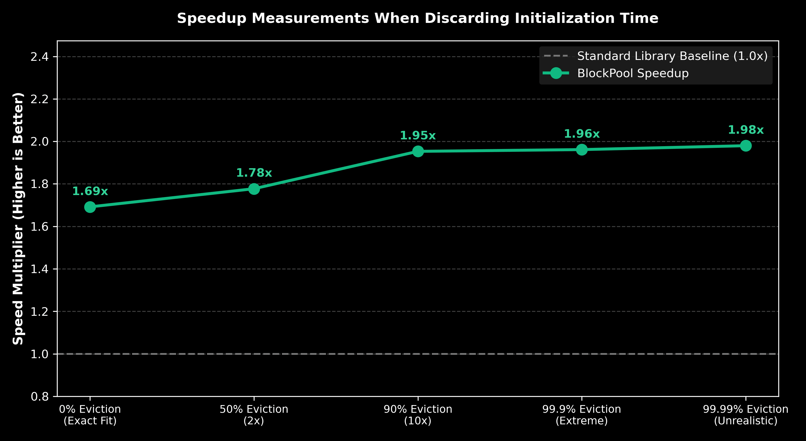
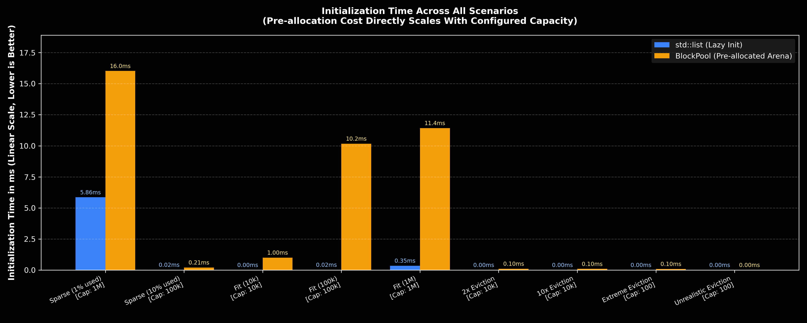
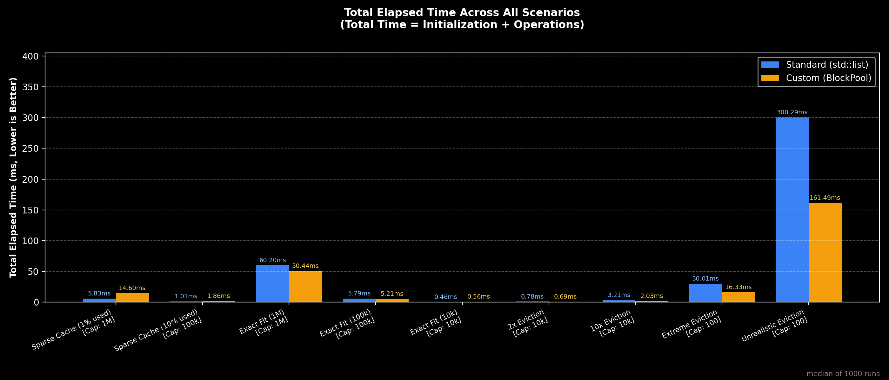

# lru

## Current Goals:

- [x] create an in memory key value storage with LRU as an eviction policy.

- [x] create a front-end CLI tool to get/put key value pairs

- [x] custom memory allocation (block pool + index-based linked list)

- [x] benchmarks comparing custom backend vs std lib

## Possible Future Goals:

* migrate to a custom hashtable, maybe/probably open addressing one

* add support for more than just int to int key value pairs.

* achieve persistence

* add multithreading support (thread-safe operations)

* separate into server-client model

* migrate to a Python based front end with richer command options

## Current Architecture:
Because I have a little bit of Web background (some react, some laravel, js, etc..) I went for an MVC inspired Architecture.

* **frontend**: primitive CLI with basic commands (`GET <key> `, `PUT <key> <value> `).

* **handlers**: `CommandHandler` dispatches commands to the configured backend.

* **backends**:

  * `backend-standard`: `std::list` + `std::unordered_map`. Uses `std::list::splice` for $O(1)$ recency bumps. Simple, relies on standard heap allocations.

  * `backend-custom`: fixed-capacity `BlockPool` + index-based `LinkedList`. Uses `uint32_t` indices instead of raw pointers to avoid heap fragmentation and dynamic node allocations. Also uses `std::unordered_map::extract` to reuse map nodes on eviction.

all single proccess single thread for now, no need to over complicate.


## building and running:

The project uses CMake (minimum version 3.20). Build type defaults to `Release` so benchmark timings are optimized.

* **build everything:**

  ```
  cmake -B build
  cmake --build build
  
  ```

* **run the targets:**

  ```
  # run the interactive CLI
  ./build/lru
  
  # run the test suite
  ./build/lru_tests
  
  # run the standard vs custom backend benchmark
  ./build/lru_bench
  
  # run the simulated workload benchmark
  ./build/lru_sim_bench
  
  ```


## manual compilation with g++ (no cmake) [NOT RECOMMENDED]

```
# this is only here incase you dont have CMake, or my CMakeLists.txt fails
# PLEASE CONSIDER NOT USING THIS ! AS THIS IS LESS TESTED !

# build and run CLI
g++ -std=c++20 -O3 -Wall -Wextra main.cpp frontend/*.cpp backend-custom/*.cpp handlers/*.cpp -o lru && ./lru

# build and run tests
g++ -std=c++20 -O3 -Wall -Wextra -UNDEBUG tests/test_lru.cpp backend-custom/*.cpp -o test && ./test

# build and run benchmarks
g++ -std=c++20 -O3 -Wall -Wextra benchmarks/benchmark.cpp backend-standard/*.cpp backend-custom/*.cpp -o bench && ./bench
g++ -std=c++20 -O3 -Wall -Wextra benchmarks/simulated_workload_bench.cpp backend-standard/*.cpp backend-custom/*.cpp -o bench_workload && ./bench_workload

```

# Benchmarking Results
In order to have less variance I ran the benchmarks 100 times (!).
In order to understand why these charts were chosen we need to understand what compromises I made when designing this system.

* All of the needed memory is allocated upfront (to improve runtime and predictability of runtime per GET/PUT)
* 8 byte pointers were switched to 4 byte indecies  (to save memory in order to make the upfront allocation more feasable)

With this in mind I chose to focus on the upfront allocation time saving.

## The first chart is meant to show how much faster the custom LRU cache is once it has been initialized:


At 0% eviction we have a 1.7x speedup even with no evictions, but once the cache is under heavy eviction churn, the custom pool is almost 2x faster because it never calls malloc/free.

This goes to show that the more eviciton you're expecting, the better the custom implementation is.

## This chart is meant to show the time it took to initialize the caches:



The trade off: std::list is lazy so its init is basically instant, while my custom pool takes a few milliseconds upfront to pre-allocate its entire memory block.

With one exception: at 1M capacity, the standard backend takes ~5ms because std::unordered_map has to allocate its bucket array upfront when reserved. std::list itself is still lazy.

## This chart is meant to show the total elapsed time when considering the total time it took to initialize and run the operations:


This shows the trend when it comes to the trade-offs made.
The custom implementation is only worth it when there is a large amount of eviction.

With one exception: if you need the runtime per operation to be predictable the custom implementation wins everytime!
since when using the list implementation you dont know if an op will allocate memory or not.


---
This concludes my LRU cache project for now :) 
thank you for reading !
